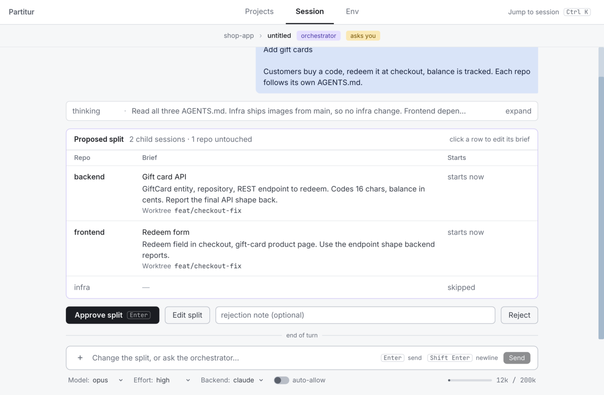
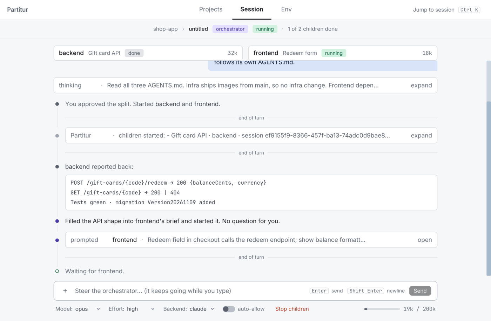

# Partitur

**The score for your coding agents.** *Partitur* is German for a conductor's score.

Partitur is a native desktop app for running AI coding agents across a whole application, not
just one repository. An orchestrator plans the change, splits it into one session per
repository and waits for your approval; the children then work in parallel, each on its own
branch or worktree if you like, and report back. It speaks the Agent Client Protocol: Claude
Code is supported today, other ACP agents are planned.

<picture>
  <source media="(prefers-color-scheme: dark)" srcset="docs/images/split-dark.png">
  <source media="(prefers-color-scheme: light)" srcset="docs/images/split-light.png">
  
</picture>

- **One plan, many repositories.** Edit, approve or reject every split before anything runs.
- **Every agent at a glance.** The main window is a session tree per project, not an editor:
  live status, `asks you` where a session waits for you, and `Ctrl K` to jump anywhere. The
  Env tab shows what shaped a session: instruction files, model, effort, backend.
- **Safe by default.** Partitur denies the orchestrator's edit, delete, move and execute
  requests, so it plans and inspects while the children change code. Branches and worktrees
  are removed only when you tick their box.
- **Native and fast.** Written in Rust with iced. Git and agent work run in the background, so
  the window stays responsive, in light and dark.
- **Built on ACP.** Your agent keeps its own setup, instruction files and accounts; several
  accounts can run side by side as backends.

<picture>
  <source media="(prefers-color-scheme: dark)" srcset="docs/images/orchestrator-dark.png">
  <source media="(prefers-color-scheme: light)" srcset="docs/images/orchestrator-light.png">
  
</picture>

The children report back while the orchestrator keeps the timeline and steers the next step.

## Install and run

You need the Rust toolchain (pinned in `rust-toolchain.toml`), `git`, Node.js (for the
`claude-agent-acp` adapter, fetched through `npx` when it is not installed) and a logged-in
Claude Code.

```sh
cargo run -p partitur
```

`PARTITUR_OPEN=<folder>` opens a folder as a project at startup, as if it had been picked in
the folder dialog. `RUST_LOG` filters the log
on stderr (default `partitur=info`).

## Quick start

1. Click `open project folder` and pick one repository, or a folder holding several.
2. Click `+ new session` (or press `N` on the Projects tab) and pick a repository, or the
   orchestrator.
3. Write a prompt. For an orchestrator, review the proposed split and click `Approve split`.

## Documentation

- [Configuration](docs/configuration.md): backends, accounts, worktree paths and other settings.
- [Keyboard](docs/keyboard.md): every shortcut.
- [Sessions](docs/sessions.md): starting, branches and worktrees, archiving and deleting.
- [Orchestration](docs/orchestration.md): how an orchestrator splits, steers and collects work.

## Development

```sh
cargo fmt --check
cargo clippy --all-targets --all-features -- -D warnings
cargo deny check
ICED_TEST_BACKEND=tiny-skia cargo test --workspace --all-features
```

## License

[MIT](LICENSE)
