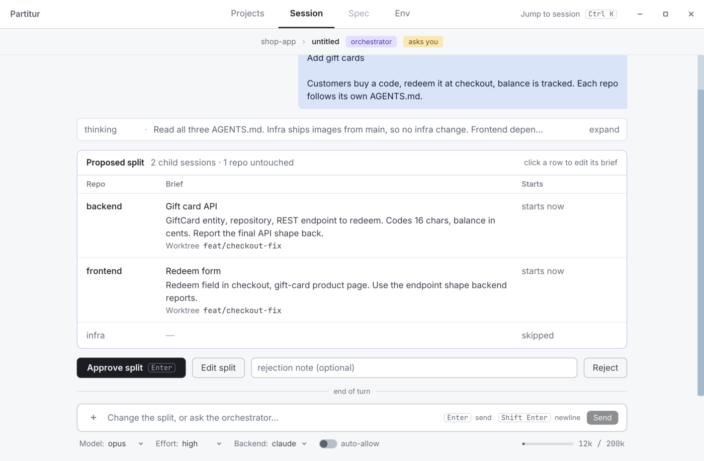
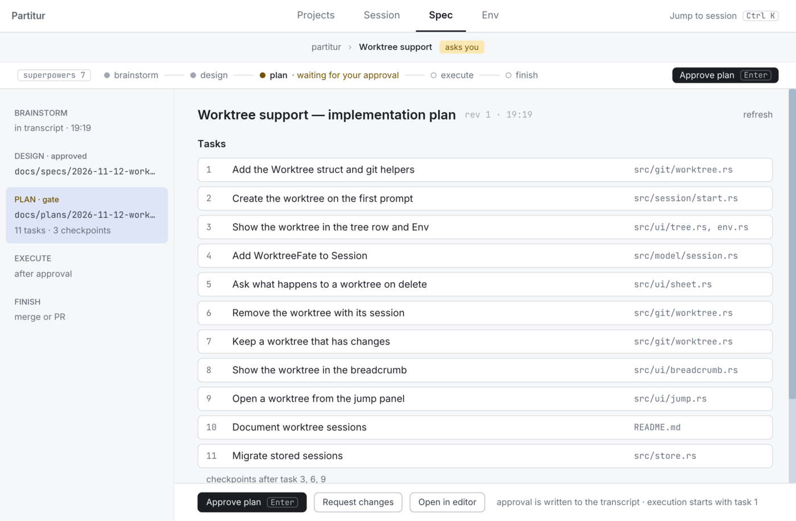

# Partitur

**The score for your coding agents.** *Partitur* is German for a conductor's score.

Partitur is a native desktop app for running AI coding agents across a whole application, not
just one repository. Agents work spec-driven: a session that follows the
[superpowers](https://github.com/obra/superpowers) workflow shows where it stands, from
brainstorm through design, plan and execution to finish, and stops at every gate until you
approve. An orchestrator splits a change into one session per repository; the children work in
parallel and report back. It speaks the Agent Client Protocol: Claude Code and GitHub Copilot
are supported.

<picture>
  <source media="(prefers-color-scheme: dark)" srcset="docs/images/split-dark.png">
  <source media="(prefers-color-scheme: light)" srcset="docs/images/split-light.png">
  
</picture>

- **One plan, many repositories.** Edit, approve or reject every split before anything runs.
- **Spec-driven, with you at the gates.** The design and the plan open in the Spec tab;
  approve them, or request changes, before execution starts. The flow rail shows the
  task at work and its test-driven phase, and `G` jumps to the session that has waited longest.
- **Every agent at a glance.** The main window is a session tree per project, not an editor:
  live status and workflow step, `asks you` where a session waits for you, and `Ctrl K` to
  jump anywhere. The Env tab shows what shaped a session: instruction files, model, effort,
  backend.
- **Safe by default.** Partitur denies the orchestrator's edit, delete, move and execute
  requests, so it plans and inspects while the children change code. Only you close a gate.
  Branches and worktrees are removed only when you tick their box.
- **Native and fast.** Written in Rust with iced. Git and agent work run in the background, so
  the window stays responsive, in light and dark.
- **Built on ACP.** Your agent keeps its own setup, instruction files and accounts; several
  accounts can run side by side as backends.
- **Widgets inline.** A tool whose MCP server ships an MCP App shows its widget right under the
  tool call, drawn by an embedded Chromium, on Linux and Windows. On macOS widgets fall back
  to the tool's text for now.

<picture>
  <source media="(prefers-color-scheme: dark)" srcset="docs/images/spec-dark.png">
  <source media="(prefers-color-scheme: light)" srcset="docs/images/spec-light.png">
  
</picture>

## Install

Releases are on the [releases page](https://github.com/mhert/partitur/releases). `SHA256SUMS`
beside the files covers every one of them; download it next to whatever you took and check
what arrived before installing it:

```sh
sha256sum --ignore-missing -c SHA256SUMS
```

On macOS the same check is:

```sh
shasum -a 256 --ignore-missing -c SHA256SUMS
```

**Arch** — the built package, or the `PKGBUILD` beside it to build your own:

```sh
sudo pacman -U partitur-<version>-1-x86_64.pkg.tar.zst
```

**Debian and Ubuntu** — take the file built for the distro you are on,
`partitur_<version>_amd64_debian13.deb` or `partitur_<version>_amd64_ubuntu24.04.deb`:

```sh
sudo apt install ./partitur_<version>_amd64_debian13.deb
```

**Other Linux** — an AppImage, for the distros the packages above were not built for. It runs
on a glibc of 2.35 or newer. Nothing is installed: make it executable and run it.

```sh
chmod +x partitur-<version>-x86_64.AppImage
./partitur-<version>-x86_64.AppImage
```

The packages put Partitur in your application menu with its icon.

**macOS** — take `partitur-<version>-aarch64-macos.tar.gz` for Apple silicon or
`partitur-<version>-x86_64-macos.tar.gz` for an Intel Mac. It runs on macOS 11 or newer. Unpack
it and drag `Partitur.app` into Applications:

```sh
tar -xzf partitur-<version>-aarch64-macos.tar.gz
```

The app is signed but not notarized, so macOS refuses the first open. Open System Settings ›
Privacy & Security and choose "Open Anyway", or clear the download's quarantine flag:

```sh
xattr -dr com.apple.quarantine /Applications/Partitur.app
```

Started from the Finder or the Dock, Partitur reads your login shell's environment, so it finds
`node`, `npx` and `git` where your terminal does. Its configuration and data live in
`~/Library/Application Support/mhert.partitur/`.

**Windows** — run `partitur-<version>-x86_64-windows.msi`. It installs Partitur into
`C:\Program Files\Partitur` with a Start menu entry, and Settings › Apps removes it again.
A Partitur installed with the earlier `…-setup.exe` (v0.2.1 and before) must be removed in
Settings › Apps first.
Rather not install? `partitur-<version>-x86_64-windows.zip` holds the same files; unpack it
anywhere and start `partitur.exe` from there. In PowerShell, compare the download's hash with
its line in `SHA256SUMS`:

```powershell
Get-FileHash -Algorithm SHA256 partitur-<version>-x86_64-windows.msi
```

The files are not signed, so SmartScreen stops the first start with "Windows protected your
PC". Choose "More info", then "Run anyway". Partitur is a window without a console, so
`--version` prints only when its output is redirected: `partitur --version | more`. Its
configuration and data live in `%APPDATA%\mhert\partitur\`; uninstalling leaves them there.

### What it needs

Every package carries the Claude Code ACP adapter, patched to show widgets, and on Linux and
Windows the embedded Chromium (CEF) that draws them. The adapter runs on the Node.js the
`.deb`, the AppImage, the macOS bundle and the Windows packages carry; the Arch package
depends on the distribution's `nodejs` instead. The packages depend on `git`, and the `.deb`
packages recommend Node.js, npm and `xdg-desktop-portal`, which apt installs by default. You
need:

- Claude Code, installed and logged in, with `claude` on `PATH`: the bundled adapter runs it.
  Without one, Partitur runs the unpatched adapter through `npx`, which needs Node.js and
  npm, and shows no widgets.
- For GitHub Copilot backends, the Copilot CLI (`npm install -g @github/copilot`, Homebrew or
  winget), installed and logged in, with `copilot` on `PATH`. It is not bundled, and its
  sessions show no widgets. See [Configuration](docs/configuration.md#github-copilot).
- git. On macOS, the Xcode command line tools (`xcode-select --install`) or Homebrew's. On
  Windows, Git for Windows (`winget install Git.Git`), with `git` on `PATH`.
- The superpowers skills in your agent, for the spec-driven workflow.

### From source

You need the Rust toolchain (pinned in `rust-toolchain.toml`) and the same things as above, and
on Linux and Windows CMake and Ninja, which build CEF's C++ wrapper. The build downloads CEF
(about 330 MB) unless `CEF_PATH` names a distribution laid out by cef-rs's `export-cef-dir`.

```sh
cargo run -p partitur
```

`PARTITUR_OPEN=<folder>` opens a folder as a project at startup, as if it had been picked in
the folder dialog. `RUST_LOG` filters the log
on stderr (default `partitur=info`).

## Quick start

1. Click `open project folder` and pick one repository, or a folder holding several.
2. Click `+ new session` (or press `N` on the Projects tab) and pick a repository, or the
   orchestrator.
3. Write a prompt. Review what comes back: an orchestrator's proposed split, or a design or
   plan at its gate, and approve it.

## Documentation

- [Configuration](docs/configuration.md): backends, accounts, worktree paths and other settings.
- [Keyboard](docs/keyboard.md): every shortcut.
- [Sessions](docs/sessions.md): starting, branches and worktrees, archiving and deleting.
- [Orchestration](docs/orchestration.md): how an orchestrator splits, steers and collects work.
- [Workflow reporting](docs/workflows.md): the flow rail, the Spec tab and the gates of a
  superpowers session.

## Development

```sh
cargo fmt --check
cargo clippy --all-targets --all-features -- -D warnings
cargo deny check
ICED_TEST_BACKEND=tiny-skia cargo test --workspace --all-features
```

## License

[MIT](LICENSE)
