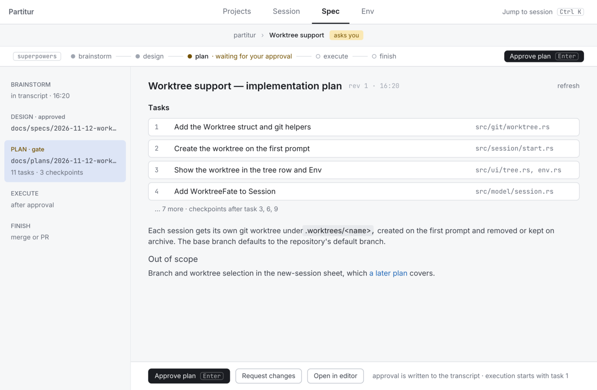

# Partitur

**The score for your coding agents.** *Partitur* is German for a conductor's score.

Partitur is a native desktop app for running AI coding agents across a whole application, not
just one repository. Agents work spec-driven: a session that follows the
[superpowers](https://github.com/obra/superpowers) workflow shows where it stands, from
brainstorm through design, plan and execution to finish, and stops at every gate until you
approve. An orchestrator splits a change into one session per repository; the children work in
parallel and report back. It speaks the Agent Client Protocol: Claude Code is supported today,
other ACP agents are planned.

<picture>
  <source media="(prefers-color-scheme: dark)" srcset="docs/images/split-dark.png">
  <source media="(prefers-color-scheme: light)" srcset="docs/images/split-light.png">
  
</picture>

- **One plan, many repositories.** Edit, approve or reject every split before anything runs.
- **Spec-driven, with you at the gates.** The design and the plan open in the Spec tab;
  approve them, or request changes, before execution starts. The flow rail shows the
  task at work and its test-driven phase, and `G` jumps to the session that has waited longest.
- **Every agent at a glance.** The main window is a session tree per project, not an editor:
  live status and workflow step, `asks you` where a session waits for you, and `Ctrl K` to
  jump anywhere. The Env tab shows what shaped a session: instruction files, model, effort,
  backend.
- **Safe by default.** Partitur denies the orchestrator's edit, delete, move and execute
  requests, so it plans and inspects while the children change code. Only you close a gate.
  Branches and worktrees are removed only when you tick their box.
- **Native and fast.** Written in Rust with iced. Git and agent work run in the background, so
  the window stays responsive, in light and dark.
- **Built on ACP.** Your agent keeps its own setup, instruction files and accounts; several
  accounts can run side by side as backends.

<picture>
  <source media="(prefers-color-scheme: dark)" srcset="docs/images/spec-dark.png">
  <source media="(prefers-color-scheme: light)" srcset="docs/images/spec-light.png">
  
</picture>

## Install and run

You need the Rust toolchain (pinned in `rust-toolchain.toml`), `git`, Node.js (for the
`claude-agent-acp` adapter, fetched through `npx` when it is not installed) and a logged-in
Claude Code. The spec-driven workflow needs the superpowers skills installed in your agent.

```sh
cargo run -p partitur
```

`PARTITUR_OPEN=<folder>` opens a folder as a project at startup, as if it had been picked in
the folder dialog. `RUST_LOG` filters the log
on stderr (default `partitur=info`).

## Quick start

1. Click `open project folder` and pick one repository, or a folder holding several.
2. Click `+ new session` (or press `N` on the Projects tab) and pick a repository, or the
   orchestrator.
3. Write a prompt. Review what comes back: an orchestrator's proposed split, or a design or
   plan at its gate, and approve it.

## Documentation

- [Configuration](docs/configuration.md): backends, accounts, worktree paths and other settings.
- [Keyboard](docs/keyboard.md): every shortcut.
- [Sessions](docs/sessions.md): starting, branches and worktrees, archiving and deleting.
- [Orchestration](docs/orchestration.md): how an orchestrator splits, steers and collects work.
- [Workflow reporting](docs/workflows.md): the flow rail, the Spec tab and the gates of a
  superpowers session.

## Development

```sh
cargo fmt --check
cargo clippy --all-targets --all-features -- -D warnings
cargo deny check
ICED_TEST_BACKEND=tiny-skia cargo test --workspace --all-features
```

## License

[MIT](LICENSE)
